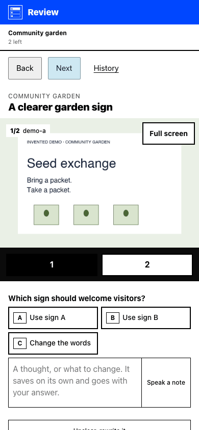
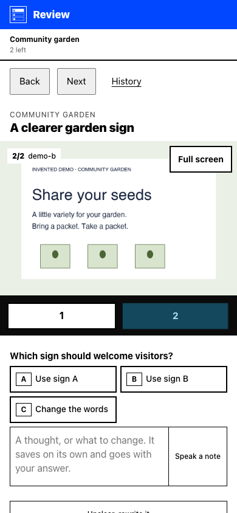
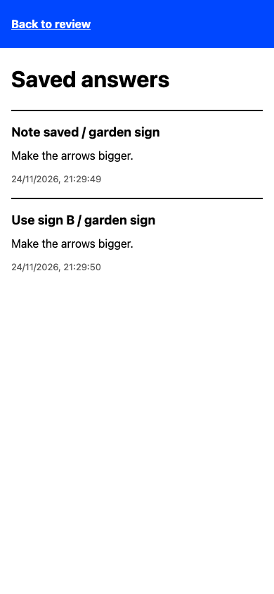
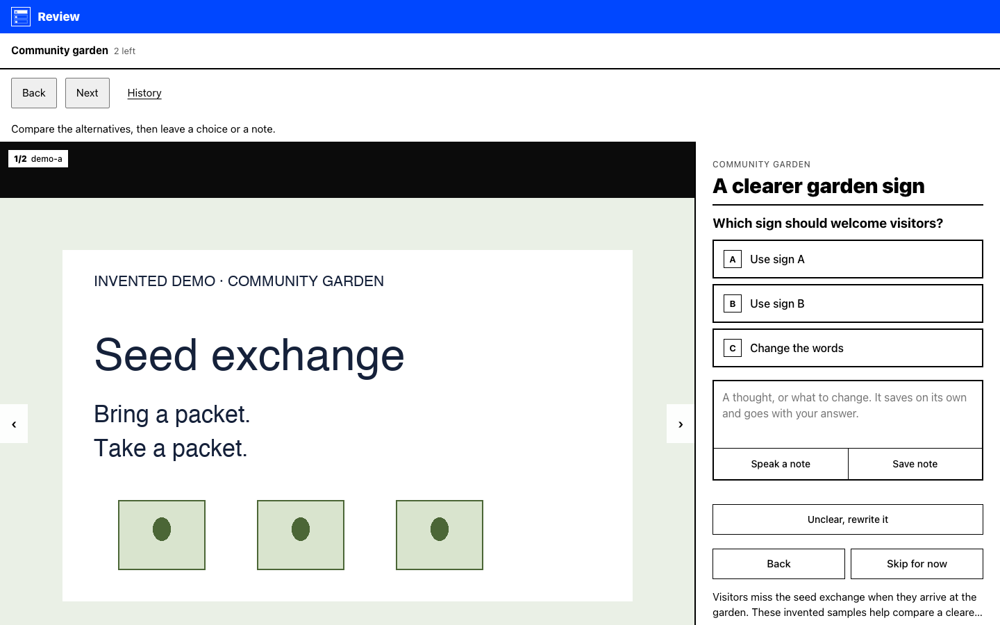

# Review panel

When a coding agent stops to ask a question in a terminal you aren’t watching, Review Panel puts that question on your phone as one card so you can tap an answer and the agent can carry on.

<p>
  
  
</p>

- See the question, screenshots or clips, and choices together on one card.
- Tap an answer and add a note with what to change.
- Keep a history of the answer, the note and the exact card you saw.

## Setup in five steps

1. Clone it: `git clone https://github.com/Morkeeth/review-panel.git`. You need Python 3.10 or newer on macOS or Linux. There are no Python packages to install.
2. Open a terminal in that folder: `cd review-panel`.
3. Run `python3 server.py`. On the first launch it copies the invented garden examples into `data/queue` and `data/media`. If port 8080 is taken, run `python3 server.py --port 8090` and open <http://127.0.0.1:8090> instead.
4. Open <http://127.0.0.1:8080> in your browser. Compare the media, type a note, then tap an answer. For a phone, follow **Use it from your phone** below.
5. Open **History**, or inspect `data/verdicts.jsonl`. The answer includes your note and the displayed card version. Its `snapshot` folder retains the card and attachments. Stop the server with Control-C.

The sample queue is seeded only when the queue directory does not exist. Restarting the server preserves answers. To start a separate demo, choose a new `PANEL_ROOT` directory.

## Demo screenshots

<details>
<summary>See History on a phone-sized screen and the card on desktop</summary>

<p></p>

<p></p>

</details>

## Publish a card

The JSON shape comes from the working panel: `id`, `title`, `project`, `created`, `what`, `why`, `question`, `options`, `media`, `lane`, `evidence` and `recommendation`. The optional `context` field adds supporting detail. See `examples/queue/garden-sign.json` and `card.schema.json`.

Copy an example to a new JSON file. Give it a new identity, a new result, one question and short options. Media paths resolve relative to `PANEL_ROOT`, or may be absolute paths within `MEDIA_ROOTS`.

```sh
python3 card_gate.py proposal.json
python3 panel_card_publish.py proposal.json
python3 panel_card_publish.py proposal.json --publish
```

The publisher checks media through the server's validator, refuses used identities and exact repeated results, and creates the queue file without replacing an existing file. The standalone card gate checks wording and structure; the publisher also checks that the attachments exist and can be served. A green check does not establish whether a proposal is useful or true.

## Use it from your phone

The phone needs HTTPS for the microphone and for the installable app. The simplest path is a private network you already trust.

**Tailscale (recommended).** Install Tailscale on the computer and the phone and sign in to the same tailnet. Stop the local quickstart server first. Choose an unused local port and run this from the clone in a private terminal:

```sh
PANEL_TOKEN="$(python3 -c 'import secrets; print(secrets.token_urlsafe(32))')" &&
[ "${#PANEL_TOKEN}" -ge 24 ] &&
export PANEL_TOKEN &&
printf '%s\n' "$PANEL_TOKEN" &&
tailscale serve --bg 8080 &&
PANEL_SECURE_COOKIE=1 python3 server.py --port 8080
```

Send the token to the phone through a password manager or another private channel you already use, and never through a public or shared chat. Once the server is running, open the HTTPS address printed by Tailscale on the phone, enter the token, then use **Add to Home Screen**. The server still listens only on 127.0.0.1; Tailscale forwards to it. To use a different port, replace both occurrences of `8080` in the block. When finished, stop the server with Control-C and run `tailscale serve --https=443 off` to remove the forwarding rule.

**Your own reverse proxy.** Start the loopback server with a long random `PANEL_TOKEN` and `PANEL_SECURE_COOKIE=1`, then forward with an HTTPS proxy that preserves the original `Host` header. For example, Caddy can use `reverse_proxy 127.0.0.1:8080`. With nginx, add `proxy_set_header Host $http_host;` to the location block so cross-origin protection can validate requests.

## Configuration and authentication

| Setting | Default | Purpose |
| --- | --- | --- |
| `PANEL_ROOT` | `data` beside the server | Queue, verdicts, snapshots and audio |
| `MEDIA_ROOTS` | `PANEL_ROOT/media` | Allowed media directories, separated by the system path separator |
| `PANEL_TOKEN` | unset | Shared access token for the reviewer and agents |
| `PANEL_SECURE_COOKIE` | unset | Set to `1` behind HTTPS |

For another local dataset:

```sh
PANEL_ROOT=./another-panel python3 server.py
```

For phone access, keep the server on loopback behind HTTPS and require a long random `PANEL_TOKEN`. Set `PANEL_SECURE_COOKIE=1` so the browser sends the login cookie only over HTTPS. The login page exchanges the token for an HttpOnly, SameSite cookie. Agent requests may use `Authorization: Bearer` with the token. Token authentication is the supported authentication method in this fork.

Media, queue, history and audio routes all require authentication when a token is configured. Only explicitly attached files inside configured roots are served. The server does not browse arbitrary files. The PWA keeps the offline shell and logo; queue data and media always use the network.

## Notes and voice

A typed note saves after a short pause. It appends a `NOTE` row and leaves the card open. An answer carries the latest note and settles the card. Failed saves stay visible and retain the text. An answer is bound to the displayed version; changes to the card or its media require a reload before saving. Repeated identical answers return the existing row.

**Speak a note** records only after a tap and microphone permission. Tap again to stop. The inherited voice guard also stops capture after inactivity or when the tab remains hidden. The IndexedDB outbox keeps pending recordings for retry, checks their audio identity, and removes them only after the server confirms durable storage. Original audio is stored locally and plays from History. There is no automatic transcription or external audio service. A microphone requires localhost or HTTPS. Physical phone recording still needs testing in your browser.

Runtime data is ignored by Git. Back up the whole `PANEL_ROOT` folder, including snapshots and audio. Treat the token as a shared secret. This is a single-reviewer app, without separate accounts or a user administration system.

## Before you publish a copy

`scripts/public_scan.py` is a leak scan and pre-push gate. It checks the tree, every commit message and patch, and attached binaries for home paths, key shapes and long numbers, plus the private words you list in a JSON file kept outside the repository. It prints counts only. Install it with `cp scripts/public_scan.py .git/hooks/pre-push`, then point it at your file with `git config publicscan.deny ~/somewhere/private.json`. Without that file the push is refused. See the top of the script for the file format.

## Coding agents

The panel is self-hosted. Its one-card flow includes a media carousel, A/B clip buttons, a full-screen viewer, typed notes and a voice outbox. The interface uses a white background, black rules and blue controls.

Each answer goes into an append-only log beside a retained copy of the card and its media.

The same instructions work in Claude Code and Codex. Copy the snippet in [AGENT-SNIPPET.md](AGENT-SNIPPET.md) into your agent's project instructions. It describes publishing, waiting, and reading the verdict without asking the same question again in chat.

The frontend was extracted from an existing working panel. The card renderer, media carousel, viewport sizing, full-screen interactions, note writes, microphone guard, retained voice outbox, durable audio archive, append boundary and PWA shell are retained or adapted. The server is a small adapter around those components. Private integrations and content were removed. Native system fonts replace the original licensed font files. [LEARNINGS.md](LEARNINGS.md) explains the decisions behind the flow; [SOURCE-MAP.md](SOURCE-MAP.md) identifies the reused components.

For automated checks, run `python3 -m unittest discover -s tests`. The optional phone browser test needs Playwright: `python3 -m pip install playwright`, `python3 -m playwright install chromium`, then `python3 tests/phone_flow.py`. It starts its own isolated server, checks a note and answer at 390 pixels, switches A/B clips, opens full-screen media and checks browser errors. A separate recording check feeds synthetic Web Audio into the native recorder and outbox; it does not test a physical microphone.
